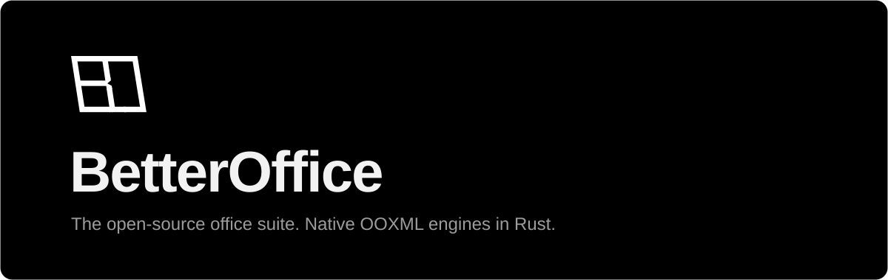

<p align="center">
  <a href="https://betteroffice.dev">
    
  </a>
</p>

<p align="center">
  Rust-native OOXML engines with collaboration and agent editing at the core.<br>
  WebAssembly for browsers. Headless APIs for servers. Native Rust where you need it.
</p>

<p align="center">
  <a href="./LICENSE"></a>
  <a href="https://www.npmjs.com/org/betteroffice"></a>
  <a href="https://crates.io/search?q=betteroffice"></a>
  <a href="https://pypi.org/project/betteroffice-xlsx/"></a>
  <a href="https://betteroffice.dev"></a>
  <a href="https://betteroffice.dev/blog"></a>
</p>

## Features

- **Documents, spreadsheets, and slides.** Open, edit, render, and save DOCX,
  XLSX and PPTX files with high fidelity. Native OOXML editing preserves untouched
  file parts losslessly when round-tripping.

- **Agent editing with human review.** Review attributed agent edits through
  tracked changes, inline diffs, and before-and-after previews. Accept or
  reject DOCX proposals in the optional proposal sidebar.

- **Real-time collaboration.** People and agents edit the same file together,
  with live cursors and selections. Concurrent changes merge automatically,
  and offline edits sync when peers reconnect.

- **Undo and redo.** Navigate editing history and undo accepted agent
  proposals as a single step.

- **Embed or automate.** Drop React editors into your app, build on the
  framework-free JavaScript cores, or use Rust and Python APIs for headless
  processing and agent workflows.

- **Open source and self-hostable.** Apache-2.0 licensed, with control over
  your document storage, deployment, and collaboration infrastructure.

[Try it out](https://demo.betteroffice.dev), or
[explore the docs](https://docs.betteroffice.dev) for setup, APIs, and format support.

## Packages

| | Rust | Core | Core (native) | React | Python |
|---|---|---|---|---|---|
| DOCX | [`betteroffice-docx`](https://crates.io/crates/betteroffice-docx) | [`docx`](https://www.npmjs.com/package/@betteroffice/docx) | [`docx-native`](https://www.npmjs.com/package/@betteroffice/docx-native) | [`docx-react`](https://www.npmjs.com/package/@betteroffice/docx-react) | [`betteroffice-docx`](https://pypi.org/project/betteroffice-docx/) |
| XLSX | [`betteroffice-xlsx`](https://crates.io/crates/betteroffice-xlsx) | [`xlsx`](https://www.npmjs.com/package/@betteroffice/xlsx) | [`xlsx-native`](https://www.npmjs.com/package/@betteroffice/xlsx-native) | [`xlsx-react`](https://www.npmjs.com/package/@betteroffice/xlsx-react) | [`betteroffice-xlsx`](https://pypi.org/project/betteroffice-xlsx/) |
| PPTX | [`betteroffice-pptx`](https://crates.io/crates/betteroffice-pptx) | [`pptx`](https://www.npmjs.com/package/@betteroffice/pptx) | [`pptx-native`](https://www.npmjs.com/package/@betteroffice/pptx-native) | [`pptx-react`](https://www.npmjs.com/package/@betteroffice/pptx-react) | [`betteroffice-pptx`](https://pypi.org/project/betteroffice-pptx/) |

**Rust:** typed engine API. **Core:** `@betteroffice/<format>`, the framework-free core through WebAssembly. **Core (native):** the same engine as prebuilt native bindings for Node.js, Bun and Deno on macOS, Linux and Windows. **React:** drop-in editor. **Python:** read, edit, render, save.

More packages:

- **Agent tools:** [`@betteroffice/agents`](https://www.npmjs.com/package/@betteroffice/agents), the TypeScript SDK and `betteroffice-mcp` server.
- **Fonts:** [`@betteroffice/fonts`](https://www.npmjs.com/package/@betteroffice/fonts), [`@betteroffice/fonts-cjk`](https://www.npmjs.com/package/@betteroffice/fonts-cjk).
- **i18n:** [`@betteroffice/docx-i18n`](https://www.npmjs.com/package/@betteroffice/docx-i18n), [`@betteroffice/xlsx-i18n`](https://www.npmjs.com/package/@betteroffice/xlsx-i18n), [`@betteroffice/pptx-i18n`](https://www.npmjs.com/package/@betteroffice/pptx-i18n).

What to install for which language, with a first example each:
[npm](https://docs.betteroffice.dev/docs/javascript),
[crates.io](https://docs.betteroffice.dev/docs/rust),
[PyPI](https://docs.betteroffice.dev/docs/python).

Upgrading from 0.4? See [Migrating to 0.5](https://docs.betteroffice.dev/docs/migrating-to-0-5).

<!-- BEGIN GENERATED VISUAL FIDELITY -->
## Benchmarks

*Generated by the [Benchmarks action](.github/workflows/visual-fidelity.yml); per-document results are on the [benchmarks site](https://benchmarks.betteroffice.dev).*

<picture>
<source media="(prefers-color-scheme: dark)" srcset="https://betteroffice.dev/api/charts/benchmarks.svg?theme=dark">

</picture>

<details>
<summary>Data</summary>

### DOCX

Page agreement is reported separately from SSIM.

<table>
<tr><th width="180"></th><th width="230" align="right">BetterOffice (<a href="https://github.com/openooxml/betteroffice/commit/3a49caad7db3114258669913e6eda9a066c50dd8">3a49caad</a>)</th><th width="230" align="right">LibreOffice (26.2.3.2)</th></tr>
<tr><td>Exact page counts</td><td align="right">63/63</td><td align="right">44/63</td></tr>
<tr><td>Absolute page error</td><td align="right">0</td><td align="right">57</td></tr>
<tr><td>SSIM</td><td align="right">0.8519</td><td align="right">0.7694</td></tr>
<tr><td>Scored/total</td><td align="right">63/63</td><td align="right">63/63</td></tr>
<tr><td>Render time (avg)</td><td align="right">430 ms</td><td align="right">773 ms</td></tr>
<tr><td>Parse success</td><td align="right">100.00%</td><td align="right">100.00%</td></tr>
</table>


### PPTX

<table>
<tr><th width="180"></th><th width="230" align="right">BetterOffice (<a href="https://github.com/openooxml/betteroffice/commit/3a49caad7db3114258669913e6eda9a066c50dd8">3a49caad</a>)</th><th width="230" align="right">LibreOffice (26.2.3.2)</th></tr>
<tr><td>SSIM</td><td align="right">0.9170</td><td align="right">0.9030</td></tr>
<tr><td>Scored/total</td><td align="right">103/103</td><td align="right">103/103</td></tr>
<tr><td>Render time (avg)</td><td align="right">159 ms</td><td align="right">1351 ms</td></tr>
<tr><td>Parse success</td><td align="right">100.00%</td><td align="right">100.00%</td></tr>
</table>

### XLSX

<table>
<tr><th width="180"></th><th width="230" align="right">BetterOffice (<a href="https://github.com/openooxml/betteroffice/commit/3a49caad7db3114258669913e6eda9a066c50dd8">3a49caad</a>)</th><th width="230" align="right">LibreOffice (26.2.3.2)</th></tr>
<tr><td>SSIM</td><td align="right">0.7661</td><td align="right">0.6892</td></tr>
<tr><td>Scored/total</td><td align="right">207/208</td><td align="right">195/208</td></tr>
<tr><td>Recalc accuracy</td><td align="right">99.60%</td><td align="right">85.87%</td></tr>
<tr><td>Recalc time (avg)</td><td align="right">64 ms</td><td align="right">405 ms</td></tr>
<tr><td>Parse success</td><td align="right">100.00%</td><td align="right">100.00%</td></tr>
</table>

</details>

For how scores, timings and coverage are measured, see the [benchmark methodology](scripts/office-quality/README.md).

<!-- END GENERATED VISUAL FIDELITY -->

## Evals

Model: `gpt-6-luna`, Harness: `codex`, three runs per task, on the v3 [format eval suite](eval/README.md): 96 basic and 33 complex editing tasks on pinned public real-world documents. A run passes only if the requested edit is correct, the rest of the file is untouched, and the input is unchanged.

<picture>
<source media="(prefers-color-scheme: dark)" srcset="https://betteroffice.dev/api/charts/evals.svg?theme=dark">

</picture>

<details>
<summary>Data</summary>

Basic tier: 96 single edits, 32 per format.

| | Generic file tools | BetterOffice MCP |
|---|---|---|
| DOCX | 43/96 | **76/96** |
| XLSX | 49/96 | **94/96** |
| PPTX | 84/96 | **92/96** |

Basic: 262/288 for BetterOffice, 176/288 for generic file tools.

Complex tier: 33 multi-step tasks, 11 per format.

| | Generic file tools | BetterOffice MCP |
|---|---|---|
| DOCX | 2/33 | **19/33** |
| XLSX | 13/33 | **31/33** |
| PPTX | 21/33 | **31/33** |

Complex: 81/99 for BetterOffice, 36/99 for generic file tools.

Generic: shell and Python with python-docx, openpyxl and python-pptx, no network. BetterOffice: only the `@betteroffice/agents` MCP server.

</details>

[Per-task results and methodology](https://evals.betteroffice.dev).

## Structure

- `crates/`: the Rust engines
- `packages/`: the TypeScript editor packages
- `bindings/`: the Python bindings
- `e2e/`: browser tests, corpus scenarios, and the shared test harness
- `apps/web`: [betteroffice.dev](https://betteroffice.dev) (Next.js on Cloudflare Workers)
- `apps/demo`: editor playground
- `apps/docs`: documentation

## Development

```bash
bun install
bun run dev:demo     # editor playground; builds the wasm bundles on first run
bun run dev          # betteroffice.dev site (no wasm needed)
bun run dev:docs     # documentation site
bun run rust:check   # fmt + clippy + tests for the engines
```

Run `bun run test:e2e:browser` for headless browser tests of all three editors.
The [E2E guide](e2e/README.md) also covers pinned corpus scenarios,
cross-SDK checks, and operation profiles.

Use the [Office visual quality harness](scripts/office-quality/README.md) to export Word, PowerPoint, and Excel references, compare local renders, or refresh the fidelity scores with the manual action.

## Contributing

Contributions are welcome. We ask for a one-time signature of the [Contributor License Agreement](CLA.md) on your first pull request ([corporate version](CCLA.md)).

## License

[Apache-2.0](LICENSE). Third-party attribution in [THIRD-PARTY-NOTICES.md](THIRD-PARTY-NOTICES.md).
